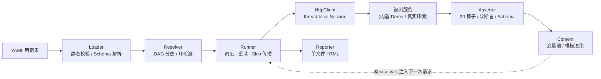

# FlowTest

> 一个 **DAG 驱动的轻量级接口自动化测试框架**：用 YAML 声明用例依赖，框架自动编排、并发执行、传递变量，最后产出一份零依赖的离线 HTML 报告。

[](https://github.com/kanoisele/flowtest-framework/actions/workflows/ci.yml)
[](https://www.python.org/)
[](#框架自测)
[](LICENSE)

**设计参考**：HttpRunner 的数据驱动思路、pytest 的 fixture/参数化理念、REST Assured 的断言 DSL 表达力。代码实现为从零编写，未复制任何现有项目源码；详见[设计参考与致谢](#设计参考与致谢)。

---

## 为什么做这个

写接口自动化时，真正耗时的从来不是「发一个请求」，而是这些破事：

| 痛点 | 常见做法 | FlowTest 的做法 |
| --- | --- | --- |
| 用例之间有数据依赖（先登录拿 token，再下单） | 靠文件名 `01_`、`02_` 硬编码顺序，一改就崩 | 显式声明 `depends_on`，Kahn 拓扑排序 + 环检测，自动分层 |
| 上游失败后下游全跑一遍脏数据 | 手动注释用例 | 失败/跳过自动向下游传播，并给出跳过原因 |
| 一个响应里 5 个字段都错了，要跑 5 遍才看全 | `assert` 遇错即停 | 软断言：一次收集全部失败点 |
| 响应结构悄悄变了没人发现 | 只断言 `status_code` | JSON Schema 契约校验，精确到出错的 JSON 路径 |
| 报告要装 Allure / 起服务 / 配 Java | 环境折腾半天 | 单文件 HTML，CI artifact 直接下载打开 |
| 环境依赖重，别人 clone 下来跑不起来 | 要 Docker、要数据库 | 内置标准库 Demo 服务，两条命令一键全绿 |

**这个项目的定位不是「一堆测试用例」，而是「造测试工具」**——测开岗位考察的是工程能力，所以重点放在框架设计、错误前置、并发模型和自测体系上。

---

## ✨ 核心特性

| 特性 | 解决什么问题 | 面试可讲的点 |
| --- | --- | --- |
| **DAG 用例编排** | 用例依赖与执行顺序 | Kahn 拓扑排序 O(V+E)、DFS 找出具体环路径、同层并行 / 跨层串行 |
| **静态 DSL 校验** | 用例写错要跑完才发现 | 加载期检查算子、JSONPath、Schema 文件、变量数据流（引用了没人产出的变量直接报错） |
| **命名空间变量池** | 变量来源说不清 | `${login.token}` 只能来自 login 用例；整串 token 保持原始类型，避免 `"3"` vs `3` |
| **21 种断言算子（含 Schema 契约）+ 软断言** | 断言能力弱、报错信息差 | 算子注册表（装饰器注册）、MISSING 哨兵区分「路径不存在」与 JSON null |
| **可解释的重试** | 重试把真 bug 掩盖了 | 仅网络异常 / 5xx 重试，断言失败绝不重试；每次尝试重新渲染 `${{uuid()}}` |
| **线程隔离的 HTTP 客户端** | 并发下 Session 串数据 | `threading.local()` 每线程独立 Session（requests.Session 非线程安全） |
| **框架自测 + CI 矩阵** | 「测测试框架的代码谁来测」 | 67 个单测 + 集成测试，4 个 Python 版本，覆盖率 + HTML 报告 artifact |
| **单文件离线报告** | 报告分享难 | 内嵌 CSS/JS、失败用例自动展开、请求头自动脱敏、重试轨迹 |

---

## 架构



一次执行的数据流：`加载 → 静态校验 → DAG 分层 → 逐层执行（同层可并发）→ 渲染请求 → HTTP → 断言 → 提取变量写入 Context → 汇总结果 → 生成报告`。

详见 [docs/architecture.md](docs/architecture.md)（含 7 条设计决策与权衡、已知局限、扩展点）。

---

## Quick Start

```bash
git clone https://github.com/kanoisele/flowtest-framework.git
cd flowtest-framework
python -m pip install -e ".[dev]"

flowtest demo            # 一键：启动内置服务 → 跑 17 个用例 → 生成 report.html → 关闭服务
```

输出：

```
执行计划: 17 个用例 / 5 层 / 并发度 2
L1/5 -> health_check, login_success, ... , flaky_recovered
L2/5 -> get_book_detail, create_order, user_profile, ...
L3/5 -> get_order
L4/5 -> cancel_order
L5/5 -> order_after_cancel
执行完成: 17 passed / 0 failed / 0 skipped, 通过率 100.0%, 耗时 686 ms
```

打开 `report.html` 即可看到完整报告（无需任何服务）。

其他命令：

```bash
flowtest validate testcases                 # 只做静态校验 + 打印 DAG 计划，不发请求
flowtest ops                                # 列出全部断言算子
flowtest run testcases --base-url https://api.example.com -p 4 --soft
flowtest run testcases --var admin_user=test01 --var expected_total=3
flowtest init my-project                    # 生成一个最小用例工程
make test                                   # 框架自测（67 个用例 + 覆盖率）
docker build -t flowtest . && docker run --rm flowtest
```

---

## 用例 DSL

```yaml
name: 订单主流程
base_url: https://api.example.com
variables:
  admin_user: admin
headers:
  X-Test-Client: flowtest

cases:
  - id: login
    name: 登录并提取 token
    request:
      method: POST
      url: /api/login
      json: { username: ${admin_user}, password: "123456" }
    extract:                        # 导出为 ${login.token}，供下游使用
      token: $.data.token
    validate:
      - check: status_code
        op: eq
        expect: 200
      - check: $.data.token
        op: regex
        expect: '^[a-f0-9]{32}$'

  - id: create_order
    depends_on: [login]             # 显式依赖，自动排到下一层
    request:
      method: POST
      url: /api/orders
      headers:
        Authorization: "Bearer ${login.token}"
      json:
        book_id: ${{random_int(101,103)}}
        request_id: ${{uuid()}}
    extract:
      order_id: $.data.order_id
    validate:
      - check: status_code
        op: eq
        expect: 201
      - op: schema
        schema_file: schemas/order.json    # 契约校验
      - check: elapsed_ms
        op: lt
        expect: 2000
        soft: true                        # 软断言：失败也继续收集其余结果
```

**约定**：JSONPath 以**响应体为根**（`$.data.token`）；另外提供 `status_code`、`elapsed_ms`、`headers.<Name>` 三个虚拟根。`${{func()}}` 是内置数据生成器，每次重试都会重新生成。

完整示例见 [`testcases/`](testcases/)：5 层依赖链、契约校验、负向用例、边界值、503 自动重试。

---

## 报告

`report.html` 是**单文件离线报告**：内嵌 CSS/JS，无外部资源，可直接作为 CI artifact 分享。

- 概览卡片：总数 / 通过 / 失败 / 跳过 / 通过率
- 按状态筛选 + 关键字搜索；失败用例默认展开
- 每个用例展示：请求（头已脱敏）、响应、逐条断言的期望 vs 实际、提取变量、重试轨迹
- 失败信息精确到断言与 JSON 路径

---

## 项目结构

```
flowtest-framework/
├── flowtest/
│   ├── core/
│   │   ├── models.py        # 纯 dataclass 数据模型
│   │   ├── loader.py        # YAML DSL + 加载期静态校验
│   │   ├── resolver.py      # DAG 分层 / 环检测 / Skip 传播依据
│   │   ├── context.py       # 变量池 + ${} 模板渲染 + 内置函数
│   │   ├── extractor.py     # JSONPath 取值（MISSING 哨兵）
│   │   ├── assertor.py      # 21 种断言算子 / 软断言 / Schema
│   │   ├── client.py        # thread-local HTTP 客户端
│   │   ├── hooks.py         # 命名式 hook 注册表
│   │   └── runner.py        # 执行引擎（分层并发 / 重试 / 汇总）
│   ├── mock/demo_server.py  # 标准库实现的被测服务，零外部依赖
│   ├── report/html.py       # 单文件 HTML 报告
│   ├── utils/               # 日志、脱敏、格式化
│   ├── examples/            # 打包内置的示例用例（供 demo 命令使用）
│   └── cli.py               # run / demo / validate / ops / init
├── testcases/               # 17 个示例用例（4 个文件，跨文件组成一张 DAG）
├── schemas/                 # JSON Schema 契约定义
├── tests/                   # 框架自身的 67 个单测与集成测试
├── docs/                    # 架构设计 / 面试题库 / 简历写法
└── .github/workflows/ci.yml # 4 个 Python 版本的 CI 矩阵
```

---

## 框架自测

测试框架本身也是软件，必须有测试：

```bash
make test
# 67 passed
```

覆盖：DAG 拓扑与环检测、变量渲染与类型保持、21 种断言算子（含 Schema 校验）、软断言、加载期静态校验、skip 传播、重试策略、fail-fast、脱敏报告，以及**对着真实 HTTP 服务跑完整 17 个用例**的集成测试。

CI 每次 push 会跑：`ruff` → `pytest --cov` → `flowtest validate` → `flowtest demo` → 上传 HTML 报告 artifact。

---

## 设计参考与致谢

本项目是学习性实现，设计上参考了以下项目的**公开思路**：

- [HttpRunner](https://github.com/httprunner/httprunner)：YAML 数据驱动、用例分层、extract/validate 的 DSL 形态
- [pytest](https://github.com/pytest-dev/pytest)：fixture 与参数化带来的可组合性理念
- [REST Assured](https://github.com/rest-assured/rest-assured)：流式、可读的断言表达
- [requests](https://github.com/psf/requests) / [jsonpath-ng](https://github.com/h2non/jsonpath-ng) / [jsonschema](https://github.com/python-jsonschema/jsonschema)：作为底层依赖使用


---

## Roadmap

留几个明确的后续方向，欢迎 PR，也适合作为面试时「下一步打算做什么」的回答：

- [ ] 用例级 `setup/teardown` 与数据库 fixture（让用例自包含数据，进一步减少对 DAG 的依赖）
- [ ] 参数化 / 数据驱动矩阵（一组数据 × 一个用例模板）
- [ ] Allure / JUnit XML 报告适配器（接入现有 CI 平台）
- [ ] 简单的 Web 用例管理界面与执行历史
- [ ] 基于响应耗时的性能基线回归（P95 趋势）

[MIT](LICENSE)
